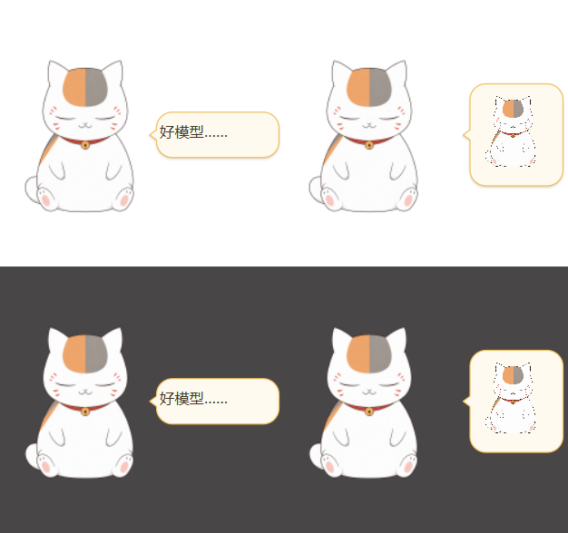
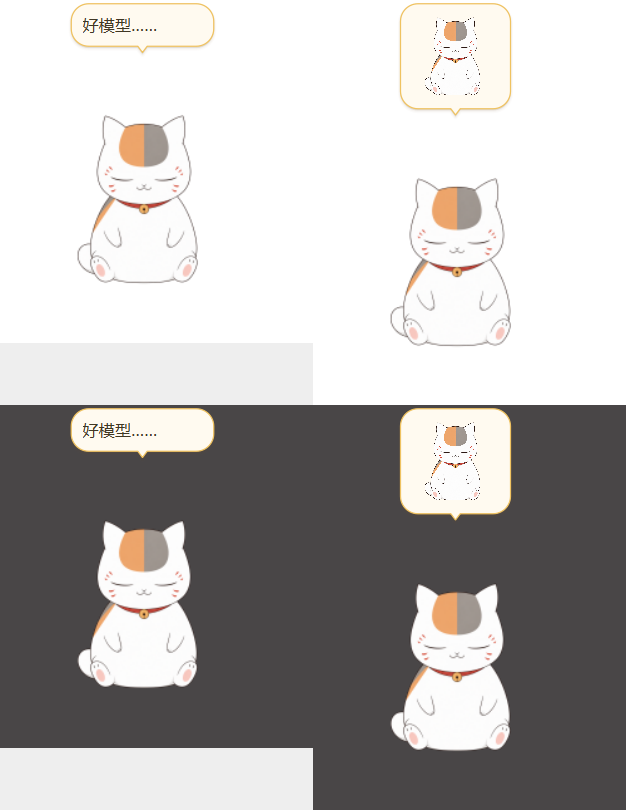

# 气泡方向修复

用户截图为经典自言自语气泡：气泡在角色右侧，尾巴却在顶部。
实际配置开启 `stream_capture_mode`。捕获子模式限定气泡位于桌宠主窗范围；
空间不足时定位函数会夹取气泡坐标，导致它与角色锚点区域略有重叠。
原方向判断只接受完全在右／左／上方，剩余情况全部当作下方，所以侧边气泡错误朝上。

新增共享 `bubble_tail_direction`：完全分离时沿用原方向，夹取后重叠时按相对中心
及两者尺寸判断朝向。文字、图片标准气泡与互动游戏结果共用规则。
未改变捕获兼容开关、字体、分页、审批按钮、显示时长或角色位置。
吐气水泡的专用装饰轮廓不在本轮修改范围内。

回归覆盖上下左右、轻微重叠、真实捕获子窗口中文字／图片的侧边方向。
修复前图片尾巴朝上，修复后两种内容均朝左。Windows 实际 Qt 预览检查明暗背景：

气泡／提醒相关 37 项通过，游戏 17 项通过，主套件 1613 通过、8 跳过；
项目既有媒体隔离族本轮未复跑，未修改媒体播放路径。Ruff 与差异格式检查通过。
本轮仅本地更新，Ubuntu 桌面观感仍需实机验收。

## 上方显示补充

前一修复只纠正尾巴方向，捕获兼容模式仍缺少用于上方气泡的主窗口空间。
文字与图片气泡现在复用已有 `set_capture_headroom`：屏幕上方足够时临时扩出透明空间，
保持角色的实际可见位置与落脚位置不变；隐藏后只回收本气泡申请的空间。
已有快速聊天占用或其他调用方扩出的空间不强行清除，屏幕顶部放不下时继续回退侧边。
不修改捕获兼容开关，也不关闭直播捕获支持。

新增检查覆盖文字／图片上方放置、角色位置不变、关闭和自动超时回收、外部扩容保留，
以及屏幕顶端不足时的回退。Windows 实际 Qt 预览通过：

超时回归使用独立 Qt 进程：初次全套在新测试的嵌套事件循环中发生原生中止，
单独运行通过；隔离后避免处理其他测试遗留的异步回调。相关 41 项及静态检查通过。
隔离后的主套件 1617 通过、8 跳过。文字与图片的上方位置、角色可见区域不变和回收
透明空间均在 Windows 实际 Qt 窗口中验证。已更新本地运行版，未推送或更新 Release。
