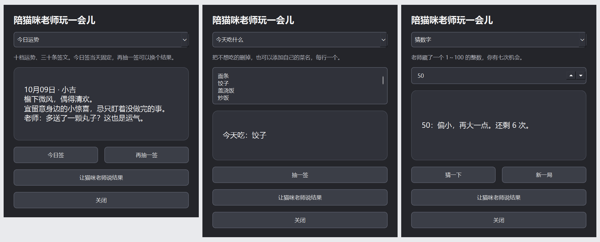

# 猫咪老师互动游戏

右键菜单 → 互动游戏。默认直接操作并由猫咪老师显示结果，不打开完整窗口。
子菜单底部的“打开互动游戏界面…”保留选项编辑与完整玩法。不修改原有动作编排和 Codex 设置。

| 玩法 | 怎么玩 |
| --- | --- |
| 今日运势 | 菜单一点击就随机抽签，不连续重复同一条。完整界面的“今日签”仍当天固定。 |
| 今天吃什么 | 内置常见餐食，候选项可编辑，每行一个，随机抽取。 |
| 自己写签 | 输入至少两个不同选项，让老师帮忙随机选择。 |
| 和老师猜拳 | 子菜单选择石头、剪刀或布，直接显示双方出拳及胜负。 |
| 猜数字 | 子菜单“猜一个数字…”只打开小输入框。1～100、七次机会，提示大小，支持新一局。 |
| 抛硬币 | 随机正面或反面。 |
| 掷骰子 | 随机 1～6 点。 |

游戏结果使用独立的限时气泡，优先在猫咪老师正上方，箭头指向角色；上方放不下时
自动避让到侧边或下方。保留签文换行，随桌宠移动。短结果显示 10 秒，文字越多显示越久，
最多 60 秒；新结果替换旧结果并重新计时。完整窗口的“让猫咪老师说结果”也走相同方式。
旧版不消失的原因是 show_alert 默认 sticky=True，传入 duration_ms 并不会取消常驻。
新路径不使用常驻提醒。不需要联网、登录或模型额度。

“今天吃什么”与“自己写签”的候选列表输入后立即自动保存，关闭窗口、重启或更新程序后保留。
右键直接抽取与完整互动窗口共用同一列表；删除和清空也保存，空列表抽取时提示补充选项。
Windows 保存于 `%LOCALAPPDATA%\NyankoSensei\games.json`，Ubuntu 保存于
`${XDG_STATE_HOME:-~/.local/state}/nyanko-sensei/games.json`，不随安装目录更新覆盖。
写入采用同目录临时文件与原子替换；损坏文件在下次保存前备份为 `games.json.corrupt-*`。
保存失败在原输入区域提示，当前编辑仍在内存中保留，再次编辑可重试。
这是游戏内容保存，不新增设置页开关；旧版仅在内存中的列表无法从磁盘迁移。
2026-10-09 用户补发的 36 个食物和 5 个“做什么”选项已同步为源码默认列表：
`nyanko_games.py` 中的 `FOODS` 与 `DRAW_OPTIONS`。首次使用采用这些默认值；以后自动读取
用户保存的列表，更新源码默认值不会覆盖用户数据。未来再修改列表会保存到用户数据文件，
不会隐式修改 Git 工作区；需要同步源码时显式同步这两个默认列表。

调研参考：[Pick4Us 随机工具](https://pick4us.com/)、
[Google Play 随机决定工具](https://play.google.com/store/apps/details?hl=zh&id=icu.yunqi.juedingyixia)。
采用常见抽签、猜数字、猜拳规则，签文和桌宠界面为本项目自行编写，未复制第三方素材。

签文参考：[神社本庁御神签介绍](https://www.jinjahoncho.or.jp/omairi/omikuji/)。
该来源说明等级与顺序因神社而异，内容也可作为日常行动的提醒。
桌宠采用自定十档：大大吉、大吉、中吉、小吉、吉、末吉、平、凶、大凶、大大凶；
大大凶是本游戏的夸张趣味档，不声称这是统一的传统等级。
每档三条，由简短签句、宜忌提醒和猫咪老师口吻的趣味评论组成；文字为原创改编，
不是动漫原台词，也不是从神社签纸逐字复制。

本地验收：游戏规则测试、真实 QMenu 触发与窗口复用、结果气泡信号、
候选项为空或重复时的提示、猜数字结束与重开。Windows Qt 字体环境渲染检查了
运势、餐食和猜数字窗口的中文、换行和按钮；Ubuntu 桌面观感仍需实机验证。
新增内容只在本地更新，未发布 Release。

限时气泡回归检查覆盖上方位置、向下箭头、10～60 秒时长边界及真实 Qt 定时器隐藏事件。
候选列表回归检查覆盖中文读写、未抽取直接关闭后的保存、重建控制器后右键读取、清空列表、
损坏文件备份及写入失败时旧文件保护。Ubuntu 路径共用实现，尚未进行本轮实机验收。
